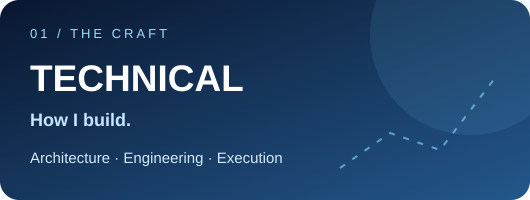
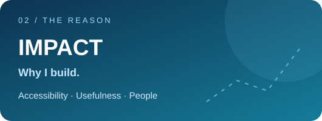
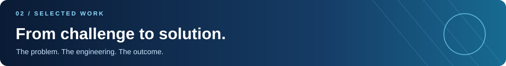
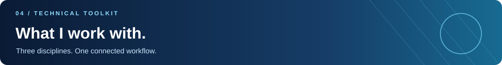
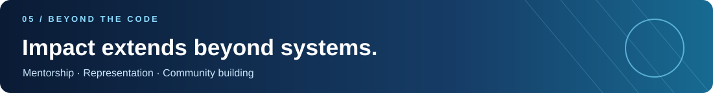
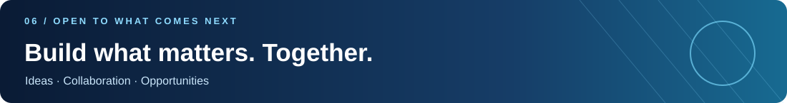

 

  

### Hello, I'm Oumayma. 👋

I'm a final-year **Data Engineering student at ENSA Al Hoceima, Morocco**. I enjoy taking an idea beyond the prototype: understanding a real challenge, shaping its architecture, building the data and AI components, and connecting the result to something useful.

My work moves between **distributed data systems, intelligent applications, and real-world problem solving**. What connects it all is not a particular technology — it's the reason to build.

> **Engineering with intention. Building for impact.**

 

## 01 / Two sides. One purpose.

<table><tr><td width="50%" valign="top">
I approach engineering through the <b>craft</b>: designing data flows, making architectural decisions, evaluating models and delivering systems that hold together beyond a demo.
</td><td width="50%" valign="top">
I measure the value of a solution by what it <b>enables</b>: clearer information, better decisions, more accessible services and useful experiences for real people.
</td></tr></table>

<b>One side gives the work its rigor. The other gives it its reason.</b>

 

### Featured engineering work

<table>
<tr><td width="50%" valign="top"><h3>🚕 TaaSim</h3>REAL-TIME MOBILITY · DISTRIBUTED DATA
<b>The question</b> How can continuous mobility data become useful insight?

<b>The engineering</b> Real-time processing with Kafka, Spark and Flink, alongside geospatial workflows, demand forecasting and trip matching.

<code>Kafka</code> <code>Spark</code> <code>Flink</code> <code>Geospatial ML</code>
</td><td width="50%" valign="top"><h3>🌐 Morafiq</h3>MULTILINGUAL INTELLIGENCE · VOYNICH SARL
<b>The question</b> How can people access complex knowledge naturally, through text or voice?

<b>The engineering</b> Built a multilingual RAG assistant <b>from scratch</b>, with corpus enrichment, cross-encoder reranking, prompt refinement and LangSmith evaluation.

<b>Measured improvement:</b> Overall Score <b>0.35 → 0.51</b>; Procedure Correctness <b>0.58 → 0.77</b>.

<code>RAG</code> <code>LLMs</code> <code>LangSmith</code>
</td></tr>
<tr><td width="50%" valign="top"><h3>📚 CDG Knowledge Assistant</h3>DOCUMENT INTELLIGENCE · CAISSE DE DÉPÔT ET DE GESTION
<b>The question</b> How can answers be retrieved from scattered web and PDF content?

<b>The engineering</b> Document-processing pipelines and a RAG chatbot using LangChain, FAISS and a Streamlit interface.

<code>LangChain</code> <code>FAISS</code> <code>Streamlit</code>
</td><td width="50%" valign="top"><h3>🧠 Brain Tumor Detection</h3>MEDICAL IMAGING · DEEP LEARNING
<b>The question</b> How can image analysis and contextual information be combined in one workflow?

<b>The engineering</b> MRI classification and segmentation, connected to an LLM and contextual RAG module for report generation.

<code>Deep Learning</code> <code>Computer Vision</code> <code>RAG</code>
</td></tr>
</table>

**🌱 Crop Yield Prediction** — Designed a leakage-free machine-learning pipeline with cross-validation and model comparison, selecting Random Forest for agricultural yield estimation (**R² = 0.98** in the reported evaluation).

 

<table>
<tr><td width="6%"><b>01</b></td><td width="94%"><h3>Data Engineering & Big Data</h3>
<i>Building, processing and managing data at scale.</i>

<code>Python</code> <code>SQL</code> <code>R</code> <code>Spark</code> <code>Kafka</code> <code>Flink</code> <code>Hadoop</code> <code>Airflow</code> <code>PostgreSQL</code> <code>MongoDB</code> <code>Cassandra</code> <code>MinIO</code>
</td></tr>
<tr><td><b>02</b></td><td><h3>AI & Machine Learning</h3>
<i>From predictive models to intelligent AI applications.</i>

<code>Pandas</code> <code>NumPy</code> <code>Scikit-learn</code> <code>TensorFlow</code> <code>Keras</code> <code>LangChain</code> <code>LangSmith</code> <code>FAISS</code> <code>ChromaDB</code>
</td></tr>
<tr><td><b>03</b></td><td><h3>Engineering Tools</h3>
<i>Building, deploying and communicating technical solutions.</i>

<code>Docker</code> <code>Git</code> <code>GitHub</code> <code>FastAPI</code> <code>Streamlit</code> <code>Power BI</code> <code>Railway</code> <code>Jupyter Notebook</code>
</td></tr>
</table>

 

### I don't want my contribution to stop at the keyboard.

Beyond technical projects, I've had the opportunity to **mentor, represent and create spaces for others to learn**. These experiences shape how I collaborate and what I consider meaningful impact.

<table>
<tr><td width="18%" align="center"><h2>01</h2><b>MENTORSHIP</b></td><td><h3>💡 DigiGirlz Mentorship Program</h3><b>STEM Mentor · Morocco · February–July 2026</b>
Supported a mentorship initiative encouraging young women to explore STEM, exchange knowledge and grow their confidence in technology.
<a href="https://drive.google.com/drive/folders/1zg9fPKLW0a4X3Zpft1zBYfw9zXuQyYjp?usp=sharing">Explore the initiative ↗</a></td></tr>
<tr><td align="center"><h2>02</h2><b>GLOBAL PERSPECTIVE</b></td><td><h3>🌍 World Youth Festival — Russia</h3><b>Moroccan Delegate · Digitalization & IT · September 2026</b>
Represented Morocco in an international setting centered on youth, technology and exchange of perspectives.
<a href="https://drive.google.com/drive/folders/1kmVN8cPN1klsGEcDfsngN-cqddhqhBDI?usp=sharing">Explore the experience ↗</a></td></tr>
<tr><td align="center"><h2>03</h2><b>COMMUNITY</b></td><td><h3>🌊 AlgoWave Programming Club</h3><b>Founder · Morocco · 2022–2023</b>
Founded a programming community built around peer learning, technical curiosity and sharing knowledge.
<a href="https://drive.google.com/drive/folders/1nWiUgq5k8Ho0xW6FgfvMqOHZZoVa920g?usp=sharing">Explore the initiative ↗</a></td></tr>
</table>

> **For me, impact is also about the people you encourage, the ideas you exchange and the communities you help create.**

 

### Open to PFE 2027 & new opportunities

Interested in **Data Engineering, AI Engineering and Data Science** opportunities in **Morocco and internationally**. Also open to **hackathons, collaborations and impactful technology projects**.

**Have an idea, a challenge, or an opportunity? I'd love to connect.**

  

ENGINEER WITH INTENTION · BUILD FOR IMPACT

